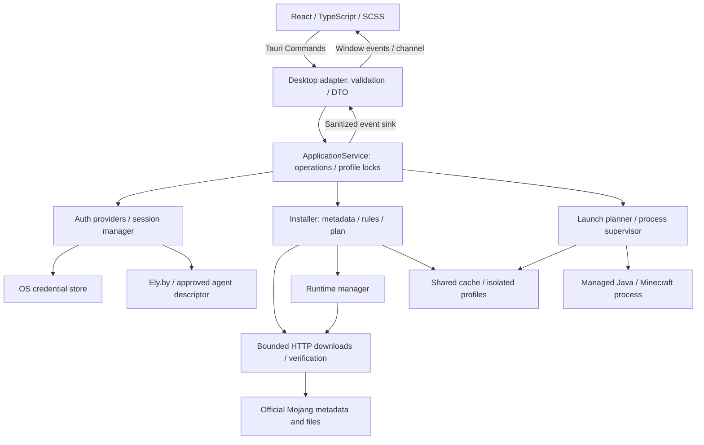
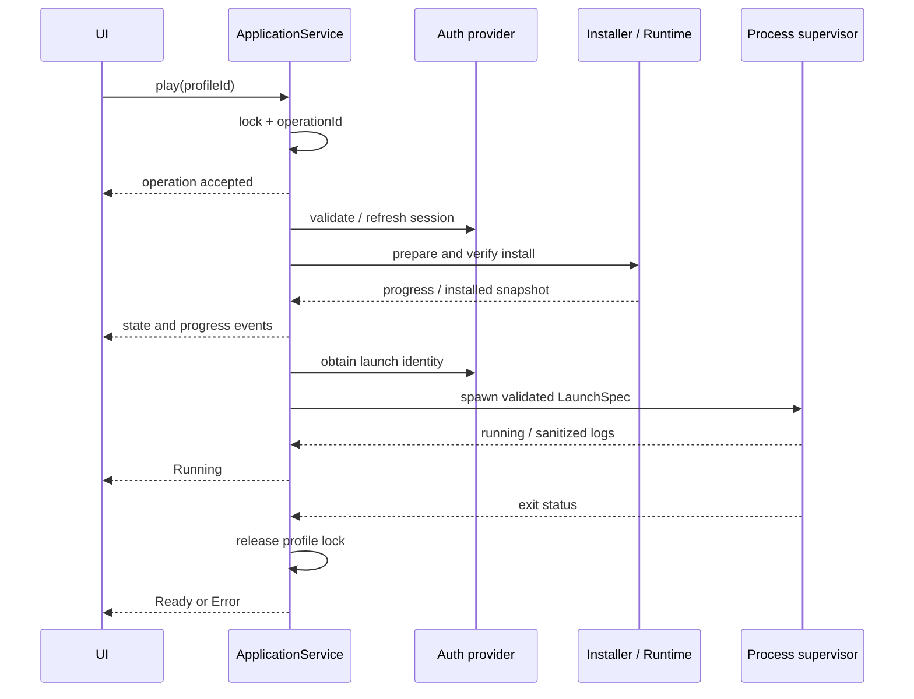

# Архитектура

Статус: архитектура Phase 0 согласована пользователем 2026-11-06. В Phase 1 реализованы workspace, read-only bootstrap core, IPC adapter и экран foundation. Installer/runtime/auth/process workflows на диаграммах ниже — целевая архитектура следующих этапов. Решения и альтернативы — в [ADR](DECISIONS/README.md).

## Границы и зависимости

Rust workspace из двух crates: `launcher-core` и Tauri desktop adapter. Core знает Tokio, HTTP и файловую систему, но не импортирует Tauri, React или IPC DTO. Один core crate с обычными модулями проще набора crates на каждый сервис; его можно тестировать и использовать из CLI без webview.

React отвечает за отображение, ввод и локальное состояние экрана. Desktop adapter валидирует IPC, разрешает app-data root, подключает credential storage, преобразует ошибки/события и владеет `ApplicationService`. Core строит планы установки/запуска и исполняет их. Зависимости передаются через конструкторы; глобального mutable state нет. Trait нужен на границе provider/credential storage/events, а не для каждого helper.



Диаграмма показывает логические взаимодействия, не отдельные системные процессы. JVM — отдельный процесс; core и adapter работают внутри Rust-процесса Tauri.

## Целевая структура и текущая реализация

В Phase 1 создана указанная Rust-структура; frontend пока имеет `features/foundation` вместо будущих auth/launcher/settings screens. Внешние сервисы описаны traits и моделями, без фиктивных реализаций. Текущий app command — только `get_snapshot`.

```text
Cargo.toml                    # workspace, общие dependency declarations
Cargo.lock
package.json                  # npm workspace и scripts
package-lock.json
rust-toolchain.toml
frontend/
  src/app/                    # bootstrap, navigation, theme
  src/features/auth/
  src/features/launcher/
  src/features/settings/
  src/shared/ipc/              # единая точка invoke/listen, типизированные DTO
  src/shared/ui/
  src/styles/
  tests/
src-tauri/
  Cargo.toml
  build.rs
  tauri.conf.json
  capabilities/
  permissions/
  src/main.rs
  src/lib.rs
  src/commands/
  src/adapters/                # events, app paths, credential store
crates/launcher-core/
  Cargo.toml
  src/lib.rs
  src/application/             # единый coordinator, operation state
  src/core/                    # metadata model, rule evaluation, errors
  src/installer/               # plans, download, verify, native staging
  src/runtime/                 # official runtime install and probe
  src/auth/                    # provider contracts, mock cfg, Ely.by
  src/launcher/                # argv builder, process supervisor
  src/profiles/
  src/storage/
  tests/fixtures/
docs/
.github/workflows/
```

`updater/` появится при реализации updater: будущий workflow подключается через application service, не меняя installer. Моды позже добавляют слой преобразования metadata в `InstallPlan`, без загрузки стороннего plugin-кода в MVP. Реально созданные foundation файлы и проверки перечислены в [отчёте Phase 1](PHASE_1_REVIEW.md).

## Управление операциями

Один coordinator атомарно захватывает profile lock до проверки, установки или запуска. Состояния backend авторитетны; повторный Play отвечает `ProfileBusy`. Shared cache имеет lock на resource key и runtime revision. Один экземпляр desktop на data root плюс OS-backed lock защищают от двух процессов лаунчера. Блокировки держатся дескриптором, не существованием stale lock-файла.

`prepare` возвращает operation ID; дальнейшая работа фоновая и отменяемая. Play оркестрирует validate auth → check/repair → runtime/native preparation → повторная session check при долгой установке → spawn. Состояние Ready не означает действительную авторизацию и не гарантирует отсутствие внешнего изменения файла после проверки.

События имеют operation/profile ID и возрастающий sequence. UI сначала подписывается, затем запрашивает snapshot; старые sequence отбрасывает. При переподключении snapshot восстанавливает состояние без постоянного polling. Прогресс ограничивается примерно 5 событиями/сек; завершение/ошибки не подавляются. Быстрые логи идут ограниченным channel, не раздувают память.

## Взаимодействие при запуске



## Принятые ориентиры

Из [Prism Launcher](https://prismlauncher.org/wiki/getting-started/data-location/) полезно разделение instances и общих библиотек/assets/Java. [XMCL](https://xmcl.app/en/core/installer) подтверждает самостоятельные задачи установки по metadata. Это исследование архитектурных подходов, без копирования их кода. Выбранный Rust workspace — наше решение для требуемого стека.

[Tauri capabilities](https://v2.tauri.app/security/capabilities/) не заменяют проверки бизнес-команд. Пользовательские app commands по умолчанию доступны зарегистрированным webviews: явно описываем их в app manifest и permissions, выдаём только окну `main`. Файловый, HTTP и shell API frontend не нужны.
